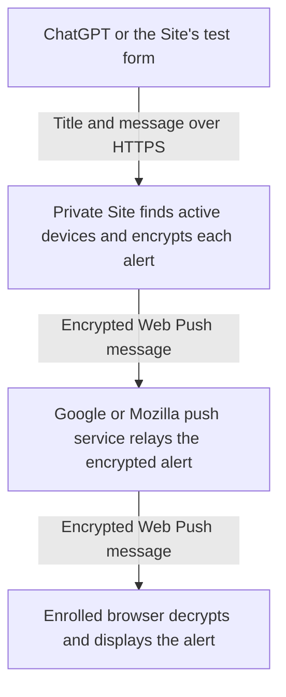

# ChatGPT Custom Notifications

Send a custom title and message from ChatGPT to your enrolled devices. The Site gives you a `send_user_notification` tool in ChatGPT Work and a private page for enrolling, testing, and managing devices.

## How it works

When you enroll a device, its browser gives the Site a delivery address and the information needed to encrypt messages for it. This is called a *push subscription*. The browser’s push service can relay notifications when the Site tab is closed.



The Site stores the subscriptions in Cloudflare D1. It uses standard Web Push and VAPID with Google and Mozilla push services. Setup requires no Firebase project, OpenAI API key, or separate mobile app.

The tool reports push-service acceptance. Check the target device to confirm that its browser and operating system displayed the notification.

## Device compatibility

| Device or browser | Support |
| --- | --- |
| Android with Chrome | Supported and verified on a physical device. |
| Android with Firefox | The Site accepts Mozilla subscriptions and the delivery path was tested in simulation. Delivery on a physical Firefox device has yet to be verified. |
| Windows, macOS, and Linux | Chrome and Firefox can enroll when Web Push is available and the browser uses a supported push endpoint. Desktop notification delivery has yet to be verified on a physical device. |
| iPhone, iPad, and Safari | Apple push endpoints are outside the current implementation. |

Notification permission must be enabled for the Site in the receiving browser. The browser and operating system control how notifications appear and whether they arrive while the browser is fully closed.

## Install your own private Site

You’ll need access to ChatGPT Sites and permission to create a Site-hosted plugin. See [Creating and using ChatGPT Sites](https://help.openai.com/en/articles/20001339-creating-and-using-chatgpt-sites) and [Hosting a plugin with ChatGPT Sites](https://help.openai.com/en/articles/20001547-hosting-a-plugin-with-chatgpt-sites).

1. From GitHub, select **Code → Download ZIP**.
2. Open a **ChatGPT Work** chat, attach the ZIP, select **@Sites**, and send the prompt below.
3. Open the published Site through the enrollment link ChatGPT gives you. Connect the generated plugin if prompted.

> Use the attached source to create a new private ChatGPT Site named **Phone Notifications** in my account. Use the repository’s hosting manifest and D1 migrations. Add the new project ID in the deployment checkout. Set `SITE_ORIGIN` to the Site’s HTTPS origin and generate a fresh VAPID key pair. Store `VAPID_PRIVATE_JWK` as a Site runtime secret. Publish with the MCP capability enabled and give me the enrollment link and plugin connection instructions.

Each installation has its own Site, database, and signing keys. The ZIP workflow uses ChatGPT Work to deploy the source. The resulting plugin connects to that installation.

### Runtime configuration

Set these values in the deployed Site’s environment. The blank [.env.example](.env.example) describes the names used by the Worker.

| Variable | Value |
| --- | --- |
| `SITE_ORIGIN` | The new Site’s HTTPS origin with no path, query, or fragment. |
| `VAPID_PUBLIC_KEY` | The base64url-encoded, uncompressed P-256 public key. |
| `VAPID_PRIVATE_JWK` | The matching P-256 private key as a JSON JWK. Enter it as a **secret** in the Site’s runtime settings. |

Keep the signing key for the lifetime of the installation. Changing it requires affected browsers to subscribe with the new key. The project ID belongs in the deployment checkout’s `.openai/hosting.json`. The source template includes the D1 and MCP declarations, and Sites applies the initial schema on deployment.

## Enroll and use

1. Open the published Site directly in Chrome or Firefox on each device you want to receive alerts on. Sign in with the account that owns the Site.
2. Enter a device name and select **Enroll this device**. Allow notifications when your browser prompts you.
3. In **Send a test**, choose a device or **All active devices**, enter a title and body, then send the test.
4. In a new ChatGPT Work chat, select **@Phone Notifications** and try “Send a notification titled ‘Backup complete’ with the message ‘The nightly backup finished successfully.’”

`send_user_notification` sends one alert to each active device. It takes `title` and `body`, plus an optional `event_id`. Retry with the same event ID, title, and body to deduplicate attempts per device for 30 days. Use a new event ID if you change the text. A retry can reach an originally eligible device after a definite send failure. Devices enrolled or resumed after the original alert do not get a replay.

## Manage devices and troubleshoot

- **Pause**, **Resume**, **Rename**, and **Remove** work from any browser signed in to the Site. A paused device stays paused until you explicitly resume it. An alert already accepted by the push service may still arrive.
- **Unsubscribe in the browser** stops notifications there. The Site removes that enrollment when the push service reports its subscription is invalid. Other active devices continue to receive alerts. To receive alerts again, restore browser permission and enroll again.
- **A send is accepted but nothing appears** means the push service accepted it for delivery. Check the receiving browser’s permission for the Site and the device’s notification settings.
- **The tool is missing in ChatGPT Work** can mean the generated plugin still needs to be installed or connected under **Plugins → Personal → Created by you**.
- **Scheduled use** should be tested in your own setup, including whether the scheduled tool call needs approval.

## Build the source locally

Use Node.js 22.13 or later. From the repository root, run:

```sh
npm ci
npm run build
```

The build produces a Cloudflare Worker and browser assets. Hosted sign-in, runtime secrets, and production D1 storage are supplied by your ChatGPT Site. The relevant source is in `app/` (enrollment UI, API, and MCP route), `lib/` (push and delivery logic), `public/phone-push-sw.js` (notification display), and `drizzle/` (D1 migrations).

The project is distributed under the [MIT License](LICENSE). The vendored components retain their upstream license notices.

## Security and privacy

- **Installation.** Review the source and dependencies before deploying code downloaded from the Internet. Publish the Site privately for your account.
- **Signing key.** Store the VAPID private key as a Site runtime secret. The enrollment page receives only the public key. Someone with the private key and the corresponding browser subscription details could impersonate the sender. If the key leaks, replace it and re-enroll affected devices.
- **Message encryption.** ChatGPT or the test form sends the title and body to the Site over HTTPS. The Site can read them and encrypts a separate copy for each browser using that subscription’s public key and shared authentication secret plus a fresh sender key pair. The browser keeps its decryption private key. The Google or Mozilla push service relays ciphertext and can see delivery metadata such as the destination and timing. It cannot read the title or body. The browser decrypts the alert before displaying it, where it may be visible on the lock screen. The VAPID key identifies the sender to the push service. Payload encryption uses separate keys. See [Web Push message encryption](https://www.rfc-editor.org/rfc/rfc8291) and [VAPID](https://www.rfc-editor.org/rfc/rfc8292).
- **Stored data.** D1 retains device names and status, Site-scoped user IDs, and browser push endpoints and encryption keys. For alerts with an event ID, it also stores a digest and per-device attempt records. Deduplication expires after 30 days, with cleanup on a later event-ID send. The app does not store the title or body in D1. Database access can reveal device and delivery metadata. A digest can also reveal whether guessed text matches an alert.
- **Access and sharing.** ChatGPT Sites handles sign-in and supplies the caller’s Site-scoped identity. The app uses that identity to restrict device management and sends to the caller’s records. The production APIs also check the Site origin for browser writes. People you share the Site with gain access under the roles you grant. Keep the Site private for personal use and share access only with people you trust. Deployment operators with database or runtime configuration access should be treated as trusted.
